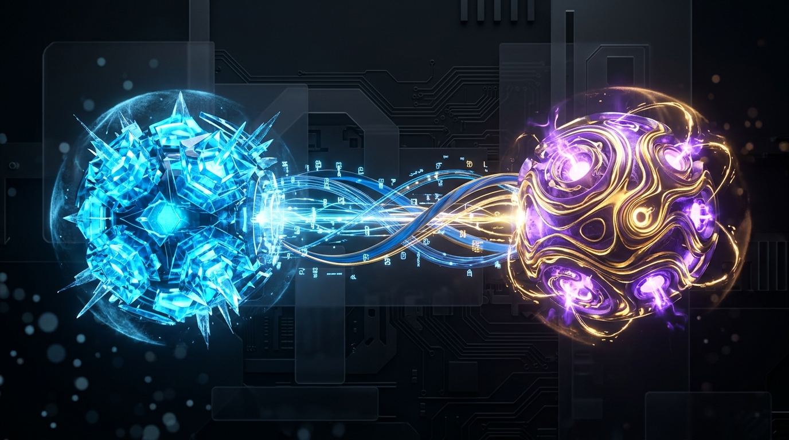

# 🌐 OmniLink: Universal Inter-Agent Communication Bus & Skills Protocol

<p align="center">
  
</p>

[](https://opensource.org/licenses/MIT)
[](https://www.python.org/downloads/)
[](#)
[](#)

> **OmniLink** is a lightweight, local-first inter-agent communication bus and standard protocol enabling autonomous AI agents (Gemini, DeepSeek, Claude, Ollama, Cursor) to discover, converse, debate, and collaborate directly on the host machine.

---

## 🌟 Why OmniLink?

Modern developers run multiple AI models and agents simultaneously (such as **Google Antigravity**, **DeepSeek Harness**, **Ollama**, and **Claude**), yet they remain isolated in separate silos. 

**OmniLink unifies them:**
* 🧠 **Architect + Builder Loop:** DeepSeek reasons through complex algorithms, while Gemini / Antigravity reviews and applies code modifications to the workspace.
* ⚡ **Zero External Dependencies:** Built purely on Python standard library with zero runtime bloat.
* 🔒 **Local & Privacy First:** All agent messages, blackboard state, and routing happen on your device.
* 🧩 **Universal Agent Skill:** Compliant with modern AI agent skill specifications (`SKILL.md`) for instant installation.

---

## 🏗️ Architecture

```
┌─────────────────────────────────────────────────────────────┐
│                    OmniLink Client (Local)                  │
│  ┌─────────────┐  ┌─────────────┐  ┌─────────────────────┐ │
│  │   Gemini    │  │   DeepSeek  │  │   Claude / Ollama   │ │
│  │    Agent    │  │    Agent    │  │      Agents         │ │
│  └──────┬──────┘  └──────┬──────┘  └──────────┬──────────┘ │
│         │                │                     │           │
│         └────────────────┼─────────────────────┘           │
│                          ▼                                  │
│  ┌─────────────────────────────────────────────────────┐   │
│  │         Universal Agent Bus (Core Engine)           │   │
│  │  ┌──────────┐ ┌──────────┐ ┌─────────────────────┐  │   │
│  │  │ Protocol │ │  Router  │ │   Context Manager   │  │   │
│  │  │ (UP-1)   │ │          │ │    (Shared State)   │  │   │
│  │  └──────────┘ └──────────┘ └─────────────────────┘  │   │
│  └─────────────────────────────────────────────────────┘   │
└─────────────────────────────────────────────────────────────┘
```

---

## 🚀 Quickstart

### 1. Installation
Clone the repository and install globally or locally:
```bash
git clone https://github.com/your-username/omnilink.git
cd omnilink
pip install -e .
```

### 2. Discover Local Agents
Check which AI engines and runtimes are active on your device:
```bash
omnilink agents
```
*Output:*
```text
=== الوكلاء المسجلون في شبكة OmniLink ===
- [deepseek] DeepSeek Intelligence Engine -> 🟢 متاح (القدرات: reasoning, code, architecture, review)
- [gemini] Gemini Execution & Synthesis Engine -> 🟢 متاح (القدرات: coding, execution, planning, tools)
- [ollama] Ollama Local Agent -> ⚪ غير متصل (القدرات: local_execution, offline, privacy)
```

### 3. Send a Message to Any Agent
```bash
omnilink send --to deepseek "حلل خوارزمية البحث هذه واقترح تحسينات الأداء"
```

### 4. Dual-Agent Collaboration Loop
Trigger an automated debate and consensus loop between two agents:
```bash
omnilink collab --architect deepseek --builder gemini "تصميم دالة بايثون لقراءة ملفات السجلات الضخمة بأقل استهلاك ذاكرة"
```

---

## 💻 Python SDK Usage

```python
from omnilink import AgentBus, OmniLinkMessage, MessageType

bus = AgentBus()

# Send a direct query
msg = OmniLinkMessage(
    src_agent="gemini",
    dst_agent="deepseek",
    content="What is the time complexity of this algorithm?",
    msg_type=MessageType.TEXT
)
response = bus.send(msg)
print(response.content)

# Trigger dual-agent collaboration
result = bus.collaborate(
    task="Build a high-performance in-memory cache",
    primary_agent="deepseek",
    secondary_agent="gemini"
)
print("Architect:", result["primary"]["response"])
print("Builder:", result["secondary"]["response"])
```

---

## 🧩 Agent Skill Integration (`SKILL.md`)

OmniLink includes a built-in agent skill definition located in `skills/omnilink/SKILL.md`. Simply point your agentic IDE (Antigravity, Cursor, or Claude Desktop) to this directory to unlock inter-agent collaboration natively.

---

## 📄 License
This project is open-sourced under the [MIT License](LICENSE).
